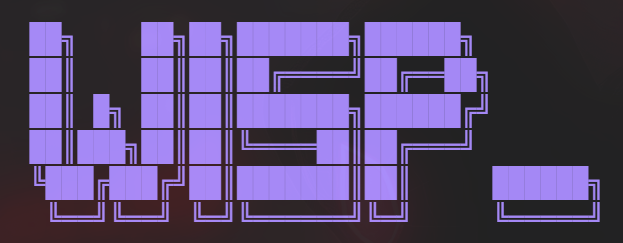
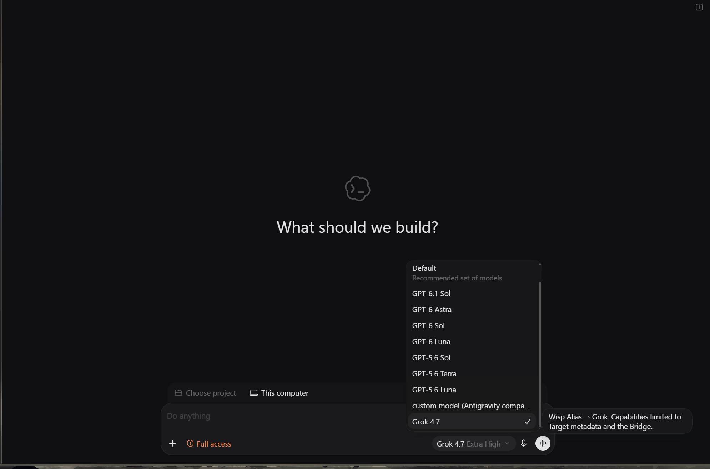
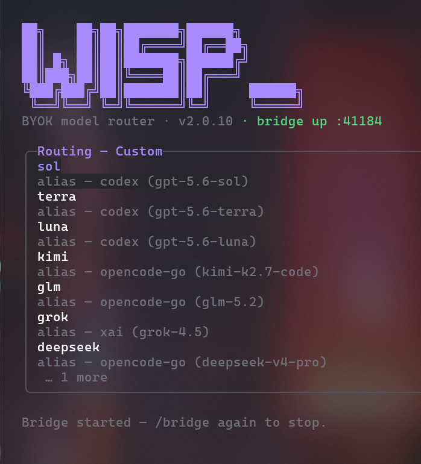
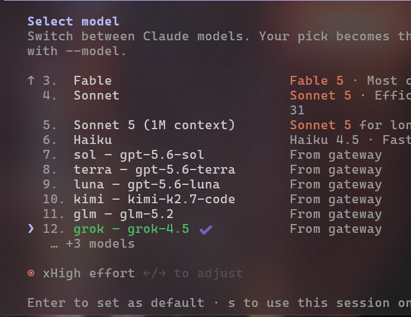
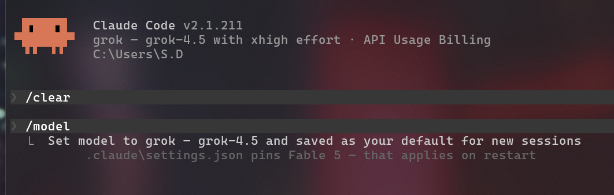

<p align="center">
  
</p>

<p align="center">
  <strong>Your models, in the coding tools you already use.</strong>
</p>

<p align="center">
  <a href="https://www.npmjs.com/package/wisp-router"></a>
  <a href="https://github.com/EstarinAzx/Wisp-Router/releases"></a>
  
  <a href="LICENSE"></a>
</p>

<p align="center">
  
  
  
  
  
</p>

---

## What is Wisp

Bring your ChatGPT or Claude subscription, API keys, or compatible local models to the tools you already code with. **Wisp lets you choose which model answers while you keep your existing workflow.**

Sign in with your **ChatGPT (Codex)** or **Claude.ai** account, or add a key for an OpenAI-compatible provider such as OpenAI, Groq, Mistral, OpenRouter, or Ollama. Manage those connections in one place, then use them where you work:

| Your tool | What Wisp adds |
| --- | --- |
| **VS Code** | Your models in Copilot Chat, Agent mode, and the `Ctrl+I` picker, with streaming, tools, and images where supported. |
| **Claude Code** | Choose your backend through the local Bridge and launch with `claude-wisp`. |
| **ChatGPT Desktop (Codex)** | Wisp aliases alongside native models, with native sign-in and voice support. **Experimental.** |
| **Terminal** | A terminal interface for providers, sign-ins, model selection, and routing, plus a Bridge you can run without the UI. |

Wisp supports subscription sign-in as well as API keys. Your existing model access stays yours; Wisp helps you use it in more places.

## Quick start

The quickest way to try the Bridge is with Claude Code. You'll need **Node.js** for the npm install and an existing **Claude Code** installation.

```sh
npm install -g wisp-router
wisp
```

Inside Wisp:

1. Open **`/providers`**, choose a provider, and sign in or add its API key.
2. Open **`/routing`**, choose a provider and model for a new alias, and give it a short name such as `grok` or `sol`.
3. Run **`/bridge`** and leave Wisp running.

In another terminal, start Claude Code through Wisp:

```sh
claude-wisp
```

Use Claude Code's **`/model`** picker to select your alias under **From gateway**. You're ready to work.

Prefer VS Code? [Install the extension](#vs-code-extension) and use your models directly in its chat and agent views. For Desktop, see the [experimental bridge setup](#chatgpt-desktop-codex-bridge--experimental) below.

## Bridge in the TUI

The **Bridge** is the local connection between Wisp and your coding tools. Run **`/bridge`** to start it or reopen its panel. You'll see the connection addresses, access secret, and the command for launching Claude Code, plus guidance for the Slot plugin and Advisor.

<p align="center">
  
</p>

Press **Esc** to close the panel and keep the Bridge running. **`/bridge off`** stops it; quitting Wisp stops it too. Keep your access secret private; the one in this screenshot is redacted.

If you prefer a terminal without the interface, run **`wisp serve`** instead. It hosts the same Bridge until you press **Ctrl+C**.

## ChatGPT Desktop (Codex) bridge — experimental

Wisp now brings your configured models into the signed-in Desktop model picker. Keep your native Codex models and add aliases for external models alongside them. Here's **Grok 4.7** selected through Wisp:

<p align="center">
  
</p>

**This integration is experimental.** Grok and the Antigravity `gemini-3.8-flash-tiered` target have passed limited Desktop checks. Other targets and Traycer GUI integration remain unverified. Each external model's tools and capabilities depend on its provider and Wisp's adapter.

Native models keep their capabilities and ChatGPT sign-in. Voice uses your existing ChatGPT sign-in and speech service, while the selected Wisp model handles the text and tool turns.

<details>
<summary><strong>Try the Desktop bridge</strong></summary>

Use terminal **2.2.5** with a matching Bridge, or companion VSIX **1.14.2** when VS Code hosts it. You'll also need an independently installed native Codex CLI. Read the [Desktop setup and rollback guide](docs/codex-desktop.md) first, especially if you already have custom Codex configuration or other clients sharing `CODEX_HOME`.

With the Bridge running, use **`/gpt-desktop on`** in Wisp and restart Desktop. To turn routing off, use **`/gpt-desktop off`** and restart Desktop again. Neither command starts or stops the Bridge. Use fresh chats when switching to external models.

The `on` shortcut enables Antigravity compatibility: developer notes become global instructions, losing their original placement and temporal scope. For strict instruction handling, use **`wisp codex-desktop enable --antigravity-instructions=strict`** instead; Antigravity is excluded in that mode.

The setup guide covers supported routes, upgrades, model refresh, and restoring your native settings. The [codex-wisp launcher](docs/codex-wisp.md) is also available for the native Codex CLI.

</details>

## Routing aliases

Give your models names you can remember. An **alias** such as `sol`, `terra`, or `grok` points to a specific provider and model. Create or change aliases with **`/routing`** in Wisp, then select them in Claude Code's **From gateway** model list.

<p align="center">
  
</p>

<p align="center">
  
</p>

Once selected, the alias is the model you work with in your session:

<p align="center">
  
</p>

Prefer scripts? **`wisp routing`** shows the map, **`--json`** returns it for scripts, and **`set`** / **`unset`** edit a row. You can also route Claude Code's `opus`, `sonnet`, `haiku`, and `fable` families to the backend you choose.

## Install

### TUI + Bridge + Claude Code launcher (npm)

```sh
npm install -g wisp-router
wisp                   # manage providers, models, and routing
wisp serve             # run the Bridge without the interface
claude-wisp            # launch Claude Code through a running Bridge
```

Use either `/bridge` in the TUI or `wisp serve` to host the Bridge. You only need one running host. The npm commands need Node.js; the compiled Wisp binaries do not need Bun. Standalone binaries for **Windows, macOS, and Linux** are available from [Releases](https://github.com/EstarinAzx/Wisp-Router/releases).

For Claude Code routed to Antigravity, **`wisp antigravity-compat on`** opts into client fallback for positioned system messages. This can keep later reminders from changing the global instruction prefix: fixed top-level system instructions stay in place, while Claude rebuilds reminders as user context; some feature-specific reminders may be omitted. Cache benefit depends on the workload. Clients without this recovery support receive an explicit error.

The option defaults to off. Use **`wisp antigravity-compat status`** to inspect it or **`wisp antigravity-compat off`** to disable it, then start a new Claude conversation (the client remembers fallback until `/clear` or `/compact`). Both Bridge hosts read `bridge.antigravityClientFallback` in `~/.wisp/config.json` live. It applies only to Messages requests routed to Antigravity; Desktop and Responses keep their existing behavior.

In the TUI, **`/antigravity-compat`** (or **`/antigravity-compat status`**) opens the current setting and guidance without changing it. Add **`on`** or **`off`** to change the same shared setting. Use **↑/↓** to scroll the explanation and **Esc** to return to the palette.

### Account quota

Use **`wisp quota`** or **`/quota`** in the TUI to view cached Claude/Codex usage, reset times and reading age. Viewing it does not contact a Provider. To update it explicitly:

```sh
wisp quota refresh              # signed-in supported Providers, one at a time
wisp quota refresh anthropic    # Claude only
wisp quota refresh codex        # Codex only
```

The TUI accepts the same arguments after **`/quota`**. **↑/↓** scrolls; **Esc** cancels a pending request or closes the result. Refreshes require a Wisp sign-in, allow at most one usage request per Provider every five minutes, and respect longer server retry deadlines. Failed or cancelled requests retain the last valid reading and its age.

The Slot statusline uses the newest complete reading from a refresh or a model turn, including before your first turn. It never refreshes automatically. Quota refresh does not change routing, models, context usage or the conversation timestamp. Readings expire after 24 hours; changes to stored credentials invalidate older readings. After upgrading, legacy quota snapshots without an account binding stay unavailable until an explicit refresh or a new metered turn from the upgraded Bridge.

### VS Code extension

Download the `.vsix` from [Releases](https://github.com/EstarinAzx/Wisp-Router/releases), then open **Extensions → ⋯ → Install from VSIX…** in VS Code. The extension is not on the Marketplace yet.

The [extension guide](packages/vscode/README.md) walks you through connecting providers, choosing models, using the Bridge, and making inline edits with Inquire. Requires **VS Code 1.104 or newer**.

### Slot skill (Claude Code plugin)

Want Claude Code to use a different Wisp model for a subagent? The **Slot plugin** teaches it how to temporarily route a Claude model family to that model and restore the original route afterward. It also adds Wisp awareness to your session.

Install it inside Claude Code:

```text
/plugin marketplace add EstarinAzx/Wisp-Router
/plugin install wisp-slot@wisp-router
```

Then ask for a subagent on the model you want, for example, "run a subagent on gpt-5.6-sol." Requires **wisp-router 2.0.24 or newer**. See the [plugin guide](plugins/slot) for the workflow and routing safeguards.

## Highlights

- **Use the access you already have.** Connect a subscription account, an API-key provider, or a compatible local endpoint. Grok (xAI) and Groq are separate providers.
- **Choose models where you work.** Use native VS Code chat and agent controls, Claude Code's model picker, or the experimental Desktop integration.
- **Keep useful model features.** Streaming, tool calling, images, reasoning effort, and context windows follow the selected model's supported capabilities.
- **Make inline edits in VS Code.** Inquire turns a natural-language request into a diff you can accept or reject.
- **Manage everything in one place.** The terminal and extension share `~/.wisp/`. API keys and tokens live in its owner-only `auth.json`, not VS Code settings.
- **Connect other compatible tools.** The secret-protected Bridge listens only on `127.0.0.1` and supports OpenAI Chat Completions, Anthropic Messages, and a native Codex subset of Responses.

## Codex model discovery

Wisp reads the model catalogue available to your signed-in Codex account, including new names, reasoning choices, image support, and context windows. It refreshes on use after 15 minutes and keeps the last successful account-specific list for temporary outages.

To refresh now, run **`wisp models codex --refresh`**, choose **Refresh models** in the terminal picker, or use the extension's refresh button. You can also enter a model manually.

This provider discovery does not require an installed Codex CLI; Wisp reads OpenAI's published package version as request metadata. The Desktop integration has its own native CLI requirement, described in its setup guide.

Claude Code's `max` effort passes through when the selected Codex model supports it; otherwise Wisp uses the model's advertised default. **Ultra** is Codex orchestration, not a Responses reasoning value, so it is not offered as a Wisp provider effort. Native Desktop choices are preserved separately.

## Repository layout

Wisp is a Bun-workspaces monorepo with three packages and one root `bun.lock`:

| Package | What you'll find |
| --- | --- |
| [`packages/core`](packages/core) | Shared provider, routing, Bridge, OAuth, and storage code. Bundled into each app; not published separately. [Core tests](packages/core/tests). |
| [`packages/vscode`](packages/vscode) | VS Code chat integration, provider panel, Inquire, and a Bridge host. |
| [`packages/tui`](packages/tui) | The terminal interface, headless Bridge, and `claude-wisp` / `codex-wisp` launchers. Published as [`wisp-router`](https://www.npmjs.com/package/wisp-router). |

## Development

Want to explore or contribute? Start at the repository root:

```sh
bun install
bun run test       # core Vitest suite
bun run compile    # extension typecheck, bundle, and webview build
```

- **Extension:** press **F5** to open an Extension Development Host. Look for Wisp in that window's activity bar. Run `bun run package` in `packages/vscode` to build a `.vsix`.
- **TUI:** run `bun run dev` in `packages/tui`. Set `WISP_HOME` to a separate directory when experimenting; otherwise it uses your real `~/.wisp` configuration.

Found a bug or have an idea? [Open an issue](https://github.com/EstarinAzx/Wisp-Router/issues) and tell us which tool, provider, and Wisp version you're using.

## Releases

For users, [GitHub Releases](https://github.com/EstarinAzx/Wisp-Router/releases) has the standalone binaries and VS Code extension; [npm](https://www.npmjs.com/package/wisp-router) provides the terminal install.

For maintainers, tag `v<version>` matching `packages/tui/package.json` and push. The Release workflow builds Windows x64, macOS arm64/x64, and Linux x64 binaries, attaches them to the release, and publishes the npm shell and platform packages. The npm shell can fall back to the matching GitHub binary download.
